**Tutorial: Multi-Dataflow Composer Tool**

CGR Coprocessor Generation for Kria KV260 Using MDC and PICEA--MLIR

# Overview of the Design Flow

This tutorial describes how to generate and deploy an AXI-based
processor--coprocessor system on the AMD/Xilinx Kria KV260 using MDC
(<http://sites.unica.it/rpct/>) and, optionally, the PICEA--MLIR
compilation flow (<https://gitlab.abinsula.com/myrtus/dpe/picea>). The
associated deployment resources are available at
<https://github.com/mcheshfar/AXI-based-driver-applications>.

The tutorial covers three alternative design flows:

1.  **MDC-only flow:** provide the dataflow networks in XDF format,
    their CAL actor interfaces, and the corresponding HDL component
    library. MDC merges the networks and generates the coprocessor and
    platform-integration files.

2.  **PICEA export with MDC merging:** start from an MLIR description
    and use PICEA to generate the XDF networks and CAL actor interfaces.
    The networks remain separate at this stage; MDC subsequently
    performs merging and generates the coprocessor and
    platform-integration files.

3.  **PICEA export with MLIR-level merging:** start from an MLIR
    description and enable region merging in PICEA before exporting the
    resulting network to XDF/CAL. MDC then uses this already merged
    network for hardware composition and platform integration.

Two approaches to preparing the actor HDL library are described: the
existing CAPH-based approach and the PICEA EmitHLS-based approach. In
the latter, PICEA generates HLS-compatible C++ implementations and an
actor-library Tcl script; executing this script with Vitis HLS
synthesizes the actor HDL components and collects them with the required
FIFO support files. The XDF/CAL descriptions specify the network
structure and actor interfaces, while the HDL library supplies the
corresponding hardware implementations.

All three flows converge on MDC for coprocessor generation and Kria
integration. The generated Vivado scripts are used to build the FPGA
bitstream, while the generated Linux package provides device-tree and
driver sources together with userspace utilities for deployment and
testing.

The running example is a multi-dataflow accelerator supporting two
edge-detection algorithms: Sobel and Roberts. Each algorithm applies a
pair of convolution kernels to a grayscale image
(Figure [1](#fig:convolution_kernels){reference-type="ref"
reference="fig:convolution_kernels"}) to identify intensity variations
associated with image edges. The two algorithms serve as selectable
configurations of the merged accelerator.

<figure id="fig:convolution_kernels" data-latex-placement="htbp">
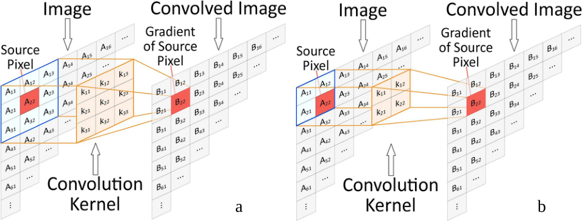
<figcaption>Computation of the convolution of kernels (x and y) of the
Sobel (a) and Roberts (b) operators with an input image
(A).</figcaption>
</figure>

Figure 2 illustrates the single networks for Sobel (a) and Roberts (b)
algorithms.

<figure id="fig:dataflow" data-latex-placement="h">
<figure id="fig:dataflow_sobel">
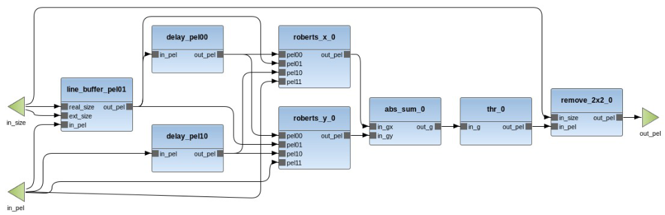
<figcaption aria-hidden="true"></figcaption>
</figure>

 

<figure id="fig:dataflow_roberts">
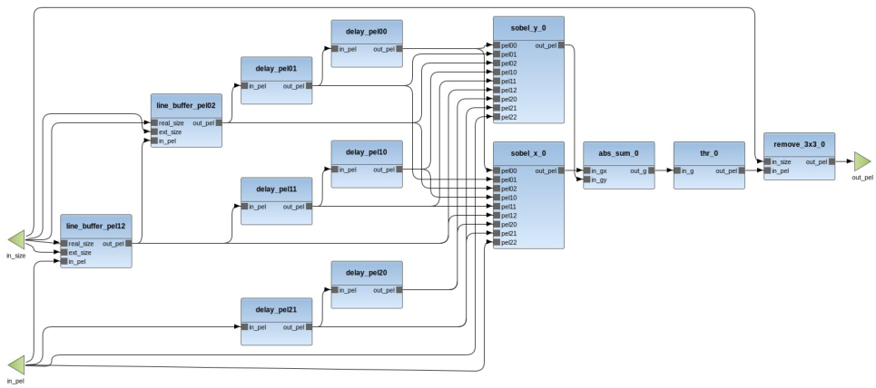
<figcaption aria-hidden="true"></figcaption>
</figure>
<figcaption>Dataflow description of the single networks for the Sobel
(a) and Roberts (b) operators.</figcaption>
</figure>

# Preparing Networks and HDL Component Libraries {#sec:preparing-networks}

The individual dataflow networks and their HDL component libraries can
be prepared using either CAPH or PICEA--MLIR.

**CAPH-based preparation.** CAPH (<http://caph.univ-bpclermont.fr>) is a
framework for specifying, simulating, and implementing stream-processing
applications based on a dynamic dataflow model of computation. In this
approach, the network descriptions and corresponding HDL components are
prepared using the CAPH-based flow and supplied to MDC for merging and
coprocessor generation.

**PICEA--MLIR-based preparation.** Alternatively, PICEA
(<https://gitlab.abinsula.com/myrtus/dpe/picea>) generates XDF network
descriptions and CAL actor interfaces from an MLIR input. Region merging
can either be performed within PICEA before export or deferred to MDC.
For hardware-library generation, the PICEA EmitHLS flow produces
HLS-compatible C++ actor implementations and a Tcl synthesis script.
Executing this script with Vitis HLS generates the actor HDL library,
including the required FIFO support files, for use by MDC. RESIN
provides a common command-line entry point for network export and
actor-synthesis input generation. **Necessary tools and resources:**

- **MDC:** required for hardware composition, coprocessor generation,
  and Kria integration ([use this
  version](https://github.com/mdc-suite/mdc/tree/mlir-frontend)). When a
  prebuilt executable is not available, follow the MDC installation
  guide
  ([docs.google.com](https://docs.google.com/document/d/1G5cKw_gC97QreTQf8Wt6QaS4xfNMwW3k0dqt0z6wVLc/edit?tab=t.0#heading=h.s5si1wegx22v)).

- **Java Runtime Environment:** required to run MDC. Use a version
  compatible with the selected MDC/Eclipse distribution ([v8 or
  higher](http://www.oracle.com/technetwork/java/javase/downloads/jre8-downloads-2133155.html)).

- **AMD Vivado:** required to generate the FPGA bitstream from the
  MDC-generated hardware and Tcl scripts. This tutorial has been tested
  with
  [Vivado 2024.2](https://www.amd.com/en/support/downloads/adaptive-socs-and-fpgas/development-tools/2026-1.html).

- **Kria KV260 board:** required for on-board execution, with a
  compatible Linux installation and the development tools and kernel
  headers needed to build the generated deployment
  software([here](https://www.amd.com/en/products/system-on-modules/kria/k26/kv260-vision-starter-kit.html)).

- **Example files:** the Sobel and Roberts network descriptions, actor
  HDL components, the corresponding MDC protocol description, and test
  inputs with reference outputs. For the PICEA-based flows, the MLIR
  source descriptions are also required
  ([here](https://github.com/mdc-suite/AXI-based-driver-applications/tree/mlir/kv260/applications/edgedetection)).

- **CAPH, when using CAPH-based preparation:** required to regenerate
  the CAPH examples and their HDL components. It is not required when
  using the supplied network descriptions and HDL library.

- **PICEA--MLIR and RESIN, when using MLIR-based preparation:** built
  with the MDC export and EmitHLS functionality enabled
  ([here](https://gitlab.abinsula.com/myrtus/dpe/picea/-/tree/dec-mdc?ref_type=heads)).

- **AMD Vitis HLS, when using EmitHLS-based library generation:**
  required to synthesize the generated C++ actor implementations into
  HDL using the generated Tcl script
  ([here](https://www.amd.com/en/support/downloads/adaptive-socs-and-fpgas/development-tools/2026-1.html)).

Before running MDC, two complementary inputs must be available: the
dataflow network descriptions and the HDL implementations of their
actors. The XDF files describe actor instances and connections, while
the CAL files define the corresponding actor interfaces. The HDL
component library provides the hardware implementations used during MDC
composition.

The following subsections describe three alternative preparation flows.
Choose one of these flows according to the source representation and the
stage at which network merging should be performed. For the PICEA-based
flows, the final subsection explains how to synthesize the actor HDL
library.

## Flow 1: CAPH-Based Preparation for MDC Merging {#sec:caph-preparation}

This flow starts from the CAPH-based example package containing the
individual Roberts and Sobel networks and their corresponding HDL
components. PICEA and RESIN are not required for this path.

Prepare the following resources:

- the separate XDF network descriptions for Roberts and Sobel;

- the CAL actor interfaces referenced by these networks;

- the corresponding actor HDL implementations and their required
  dependencies;

- the MDC protocol description matching the interfaces of these HDL
  components.

When using the supplied example package, these resources are already
available. CAPH is required only when regenerating or modifying the
CAPH-based implementations.

Keep the two networks separate during this preparation stage as shown in
Figure [4](#fig:dataflow){reference-type="ref"
reference="fig:dataflow"}. Both networks will subsequently be supplied
to MDC, which identifies compatible actors, performs network merging,
and inserts the switching structures required to select between the
Roberts and Sobel configurations.

The HDL library and protocol description must correspond to the same
actor-interface convention. In particular, the data, handshake, clock,
and reset signals described by the protocol must match the supplied
hardware components.

## Flow 2: PICEA--MLIR Export with Merging in MDC {#sec:picea-mdc-merging}

This flow starts from an MLIR file containing the individual dataflow
regions. PICEA prepares these regions and exports their network
descriptions without merging them. MDC performs the merging step later.

From the PICEA repository root, run:

    resin robertsobel.mlir --mdc --mdc-actors --hls-target-device=xck26-sfvc784-2LV-c -o build

The `--mdc` option enables MDC preparation and XDF/CAL export. The
`--mdc-actors` option additionally generates the actor-synthesis inputs
through EmitHLS. The `--hls-target-device` option specifies the FPGA
device used for actor synthesis.

**Do not enable `--merging` in this flow.** The exported networks must
remain separate so that MDC can perform the merging step.

The generated output contains Figure
[5](#fig:resin_rs){reference-type="ref" reference="fig:resin_rs"} files
and directories:

<figure id="fig:resin_rs" data-latex-placement="htbp">
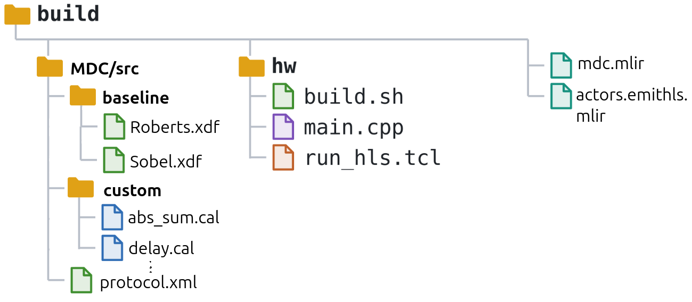
<figcaption>The generated output for resin without merging in
PICEA</figcaption>
</figure>

The file `mdc.mlir` contains the prepared DFG representation. The
`MDC/src/baseline` directory contains the exported networks and their
diagram files, while `MDC/src/custom` contains the CAL actor interfaces.
Network filenames depend on the names defined in the input MLIR.

The file `actors.emithls.mlir` contains the representation used for
actor code generation. The `hw/main.cpp` and `hw/run_hls.tcl` files are
the inputs to the actor-library synthesis procedure described in
Section [2.4](#sec:actor-hdl-generation){reference-type="ref"
reference="sec:actor-hdl-generation"}.

After synthesizing the HDL library, supply the separate exported
networks, the HDL components, and their matching protocol description to
MDC.

## Flow 3: PICEA--MLIR Region Merging and Export {#sec:picea-region-merging}

This flow also starts from an MLIR description, but performs region
merging within PICEA before XDF/CAL export. MDC then receives the
already merged network and performs the remaining hardware-composition
and platform-integration steps.

Enable MLIR-level merging by adding `--merging`:

    resin robertsobel.mlir --mdc --mdc-actors --merging --hls-target-device=xck26-sfvc784-2LV-c \
    -o build

The output follows the same directory organization as Flow 2 as shown in
Figure [6](#fig:resin_rsMr){reference-type="ref"
reference="fig:resin_rsMr"}. However, the prepared MLIR and exported
network now represent the result of PICEA region merging, including the
switching structures required by the merged graph.

<figure id="fig:resin_rsMr" data-latex-placement="htbp">
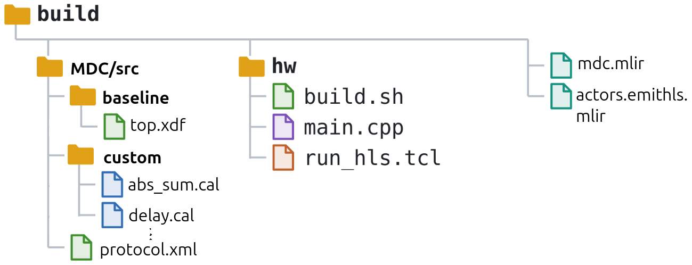
<figcaption>The generated output for resin without merging in
PICEA</figcaption>
</figure>

**The already merged network is the input to MDC for this flow.** Do not
additionally provide the original separate networks as merging inputs,
because this would mix the two alternative preparation paths.

Generate the actor HDL library from the synthesis files produced by this
same RESIN invocation. Keeping the exported network and actor library
from the same prepared input avoids inconsistencies in actor names,
interfaces, and automatically generated adapters.

The choice between Flow 2 and Flow 3 determines the location of the
merging step. It does not imply that the two merging implementations
necessarily produce identical graph structures or hardware-resource
usage.

## Generating Actor HDL Libraries with EmitHLS and Vitis HLS {#sec:actor-hdl-generation}

For both PICEA-based flows, RESIN generates the source files required
for actor synthesis. **RESIN does not execute Vitis HLS in the commands
shown above.** HDL generation is performed by running the generated Tcl
script explicitly.

For Flow 2 or Flow 3, execute:

    cd build/hw
    vitis-run --mode hls --tcl run_hls.tcl

Each command assumes that the Vitis HLS environment has been configured
and that `vitis-run` is available in the shell.

The generated Tcl script creates a separate synthesis project for each
selected actor and collects the resulting RTL in `HDL_components`. With
the FIFO-support export update, this directory also contains the shared
FIFO wrapper and its RTL dependency:

    hw/
        main.cpp
        run_hls.tcl
        HDL_components/
            mdc_hls_fifo_native.v
            top_fifo_w32_d4_S.v
            <actor_1>/
            <actor_2>/
            ...

Actor-directory names depend on the input application. When preparation
inserts additional actors, such as boundary packing and unpacking
adapters, their implementations must also be included in the synthesized
library.

The wrapper `mdc_hls_fifo_native.v` instantiates the FIFO defined in
`top_fifo_w32_d4_S.v`. Both files must therefore remain available to the
subsequent hardware-composition flow.

#### Regenerating the synthesis inputs manually.

RESIN normally coordinates C++ and Tcl generation. For debugging or
selective regeneration, the corresponding translation commands can also
be executed directly. For example, from the PICEA repository root
(remove --merging for Flow 2):

    picea-opt robertssobel.mlir   --merging  --prepare-for-mdc    -o robertssobel.mdc.mlir
       
    picea-opt robertssobel.mdc.mlir   --convert-to-emithls --for-mdc   -o actors.emithls.mlir

    picea-translate robertssobel.mdc.mlir  --dfg-to-mdc --mdc-output-dir=build

    picea-translate actors.emithls.mlir --emithls-to-cpp -o build/main.cpp

    picea-translate actors.emithls.mlir  --emithls-to-hls-tcl --hls-actor-library \
    --hls-source-file=main.cpp  --hls-target-device=xck26-sfvc784-2LV-c -o .build/run_hls.tcl

Both translations must use the same EmitHLS input. The actor-library
exporter uses the generated actor inventory to select synthesis targets.
An explicit `--hls-actors` argument overrides that inventory; omit it
when the intention is to synthesize all recorded actors, including
automatically inserted adapters.

#### Inputs to the next stage.

After synthesis completes successfully, the PICEA-based preparation flow
provides:

- the exported XDF networks and CAL actor interfaces;

- the synthesized actor HDL library and its dependencies;

- a matching FIFO protocol description, supplied separately for MDC
  integration.

These resources are used in the next section to configure MDC and
generate the Kria coprocessor.

# Configuring MDC for Coprocessor Generation {#sec:mdc-configuration}

After preparing the networks and HDL component library, configure MDC to
compose the accelerator and generate the Kria integration files. The
three preparation flows converge at this stage. Their principal
difference is whether MDC receives separate networks or a network
already merged by PICEA.

Use a dedicated output directory for each experiment. Keeping the
outputs of different flows separate simplifies validation and prevents
files from previous runs from being mistaken for newly generated
results. []{#sec:import-networks label="sec:import-networks"}

<figure id="fig:creatpro" data-latex-placement="h">
<figure id="fig:proj">
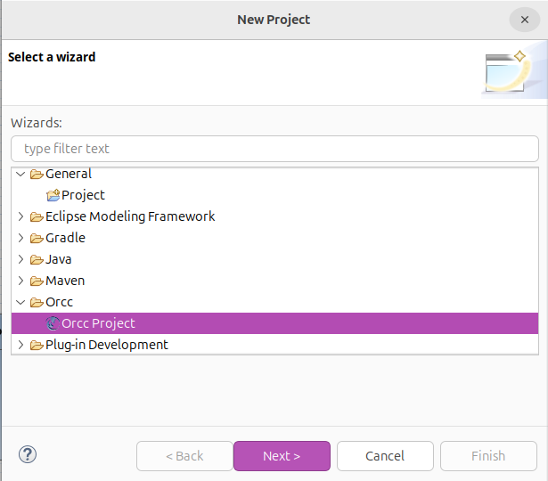
<figcaption aria-hidden="true"></figcaption>
</figure>
<figure id="fig:name">
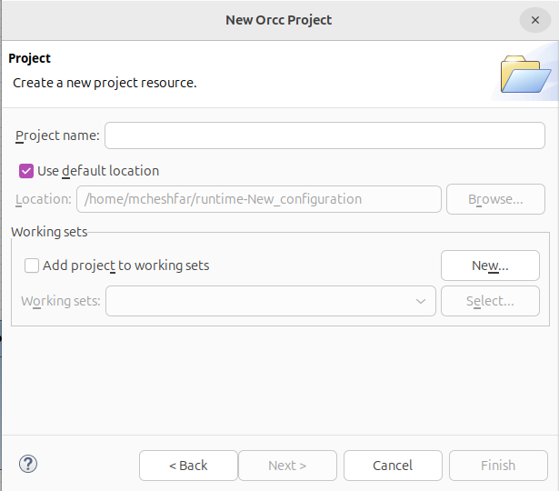
<figcaption aria-hidden="true"></figcaption>
</figure>
<figcaption>Create project steps.</figcaption>
</figure>

## Importing the XDF Networks and CAL Actor Interfaces

Run MDC tool (in Windows launch MDC executable, in Linux run it by
eslipse ) and import the prepared network project into the workspace.
For the PICEA-based flows, use the generated `MDC` directory, preserving
the source organization:

    MDC/
        src/
            baseline/
                *.xdf
                *.xdfdiag
            custom/
                *.cal

The `baseline` directory contains the network descriptions, while
`custom` contains their CAL actor interfaces. Preserve this organization
so that actor references in the XDF files resolve correctly.

If the generated directory does not contain Eclipse project metadata,
create an appropriate Orcc project in the workspace and copy the
generated source tree into its source directory see figure
[9](#fig:creatpro){reference-type="ref" reference="fig:creatpro"} .

Refresh the project after copying or regenerating files. Open the XDF
networks and check that all actor instances and connections are resolved
before launching MDC. The `.xdfdiag` files support graphical
visualization; the `.xdf` files are the network inputs to compilation.

Create or edit the MDC launch configuration and select the imported
project. Add the required XDF files to the input-network list. The
configured number of input networks must equal the number of XDF files
selected.

For the Roberts--Sobel example, select both individual networks when
merging in MDC like Figure [4](#fig:dataflow){reference-type="ref"
reference="fig:dataflow"}. When using PICEA region merging, select only
the exported merged network.

## Configuring Network Merging or Using a Premerged Network {#sec:merging-configuration}

For Flow 1 and Flow 2, provide the separate Roberts and Sobel networks
and select the MDC merging algorithm. When using the Moreano-based flow
described in this tutorial, select the corresponding Moreano option.

MDC identifies compatible actor instances and connections, constructs
the merged network, and generates the switching structures needed to
activate each configuration. The resulting accelerator contains shared
hardware where compatible operations can be reused.

For Flow 3, provide the single network already merged by PICEA. The
input-network count is therefore one, even when that network represents
multiple functional configurations.

**The number of input XDF files and the number of runtime configurations
are different concepts.** A single premerged XDF can represent both
Roberts and Sobel.

This path requires the MDC version supporting the PICEA-exported
switching and configuration metadata. The existing switching structure
and its mode information must be preserved during hardware generation.
Selecting one XDF file alone does not establish that its internal
configurations have been imported correctly.

Create a new run configuration: Run \> Run configurations... , right
click on Orcc compilation then select New. Now, chose a name for the
configuration, and select Tutorial_EdgeDetection project your PICEA
project, MDC backend and the output folder path, Figure
[10](#fig:config1){reference-type="ref" reference="fig:config1"}.

<figure id="fig:config1" data-latex-placement="h">
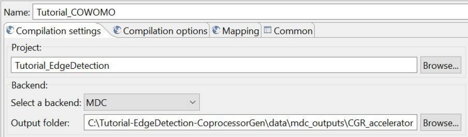
<figcaption>run configuration for select project</figcaption>
</figure>

For Flow 1 and Flow 2, select the two input dataflow networks:
edgeDetection.roberts and edgeDetection.sobel and choose the merging
algorithm (EMPIRIC or MOREANO, ref). In this tutorial we adopt the
Moreano one ,Figure [11](#fig:config2){reference-type="ref"
reference="fig:config2"}. For Flow 3, enable Accept Merged Network and
set 1 for number of networks.

<figure id="fig:config2" data-latex-placement="h">
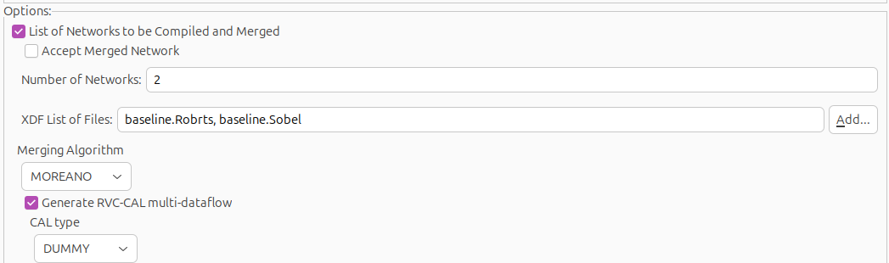
<figcaption>merging options</figcaption>
</figure>

After generation, inspect `configNetID.txt` and confirm that the
expected configurations are present. Use the generated mapping when
selecting modes in the test application; do not assume that
configuration IDs are identical across independently generated builds.

For merging networks Tick "Generate RVC-CAL multi-dataflow". And Run.

This step merges the two input dataflow networks, through the selected
datapath merging algorithm. Click on Run.

Refresh the project folder to visualize the output folder with the
generated multi-dataflow. In the generated networks you can notice as
actors are shared, and functionalities of the two input networks are
guaranteed by the insertion of the switching boxes as shown in Figure
[12](#fig:mergednet){reference-type="ref" reference="fig:mergednet"}.

<figure id="fig:mergednet" data-latex-placement="h">
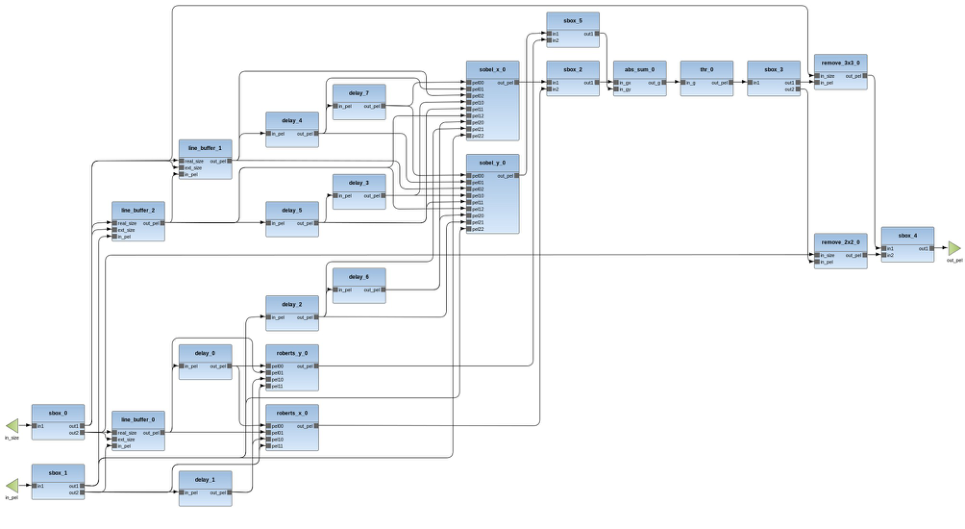
<figcaption>merged network</figcaption>
</figure>

## Selecting the HDL Library and Protocol Description {#sec:hdl-protocol}

Open again the configuration window: Run \> Run configurations... Choose
previous configuration, unselect "Generate RVC-CAL multi-dataflow" and
tick "Generate HDL multi-dataflow" as Figure
[13](#fig:hdloption){reference-type="ref" reference="fig:hdloption"}.
Enable HDL generation and specify the HDL component library and its
matching protocol description.

<figure id="fig:hdloption" data-latex-placement="h">
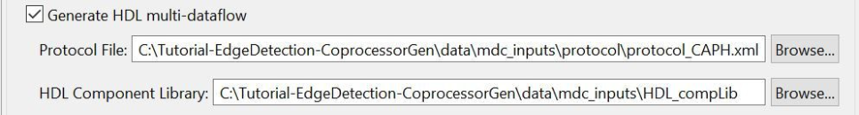
<figcaption>The HDL component library options</figcaption>
</figure>

For the CAPH-based flow, select the supplied CAPH [HDL
library](https://drive.google.com/drive/folders/1au0F4E8QVDqZaL0TMWrrsKMHWlGEcQQM)
and the corresponding CAPH protocol
[file](https://drive.google.com/drive/folders/119dGOHhdyoGmOHCXryL6khIiJ3Ntfl9X).
Include the supporting VHDL packages and FIFO modules required by the
actor implementations.

For the EmitHLS-based flow, select the `hw/HDL_components` directory
produced by the Vitis HLS script. For example:

    build/hw/HDL_components

Select `protocol_emitHLS.xml` as the matching protocol description. Use
its location in the prepared example package or generated MDC project,
as applicable to the RESIN version being used.

The protocol description tells MDC how to connect the actor data ports,
handshake signals, and system signals. It must match the interfaces
implemented by the selected HDL library.

**The CAPH and EmitHLS libraries require their corresponding protocol
descriptions.** A network with correct actor names can still produce
incorrect hardware connections if the selected protocol does not match
the actor interfaces.

## Configuring the Kria KV260 Target {#sec:kria-target}

To generate the Ip, as shown in Figure
[14](#fig:copoption){reference-type="ref" reference="fig:copoption"}
enable **System Generation** and **Generate Accelerator IP** for
coprocessor generation. For the streaming coprocessor flow used in this
[tutorial](https://www.xilinx.com/support/documents/ip_documentation/axi_ref_guide/latest/ug761_axi_reference_guide.pdf),
select the `STREAM` interface type and `ARM` for Host Processor. Enable
`Adop DMA`.

<figure id="fig:copoption" data-latex-placement="h">
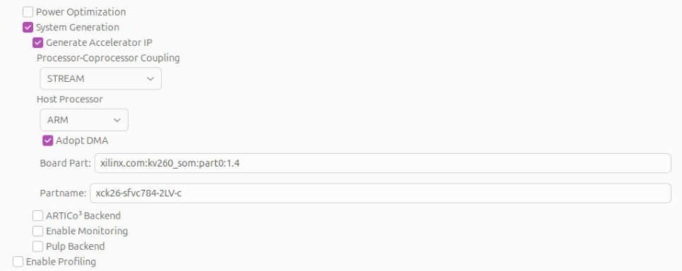
<figcaption>Coprocessor Generation options</figcaption>
</figure>

Enter the following target identifiers:

    Board part: xilinx.com:kv260_som:part0:1.4
    Part name:  xck26-sfvc784-2LV-c

The board-part identifier must be available in the Vivado installation
used for the build. The FPGA part must also agree with the device
selected during Vitis HLS actor synthesis.

The board and part fields specify the hardware target; they do not
replace the generation-enable options. Apply the launch configuration
before running MDC.

Choose a fresh output directory, for example `MDCoutput`, and launch
generation. Review the console for unresolved actors, missing HDL
dependencies, protocol errors, or generation failures.

Successful MDC execution produces the accelerator sources and
platform-integration files. **The FPGA bitstream is generated
subsequently by executing the Vivado build flow.**

# Understanding the MDC-Generated Files {#sec:mdc-generated-files}

The generated output separates the accelerator implementation, Vivado
integration, and Linux software, as shown in Figure
[15](#fig:mdcfiles){reference-type="ref" reference="fig:mdcfiles"}.
These groups serve different stages of the deployment process and should
be retained together as one build package.

<figure id="fig:mdcfiles" data-latex-placement="h">
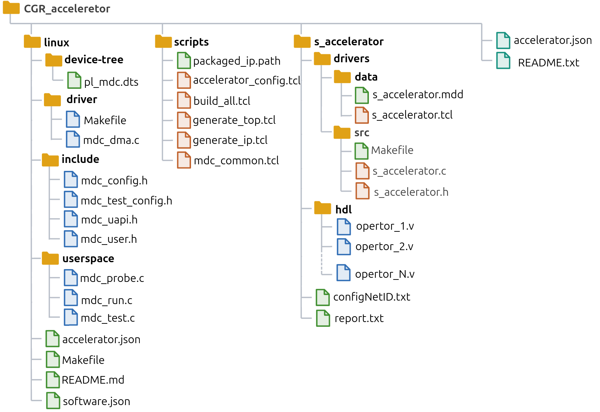
<figcaption>Coprocessor Generation options</figcaption>
</figure>

The following subsections describe the principal outputs of the updated
Kria flow. Some additional files and directory names depend on the
enabled generation options and the MDC revision.

The accompanying `report.txt` records information about network
composition and sharing. It is not a substitute for Vivado utilization
and timing reports. The `configNetID.txt` file maps network
configurations to the IDs used for mode selection.

## Accelerator HDL and Packaged IP {#sec:accelerator-ip}

For the streaming coprocessor, the `s_accelerator` directory contains
the generated accelerator hardware. The composed dataflow network is
represented by `multi_dataflow.v`, together with the actor
implementations, switching logic, FIFO support, and interface modules
required by the selected configuration.

The generated wrapper connects the dataflow network to the coprocessor
interfaces. The actor-level FIFO protocol and the processor-facing AXI
interfaces serve different roles: the former connects computational
components inside the accelerator, while the latter supports system
integration and processor communication.

The packaged accelerator IP is organized under `acc_ip`. Its principal
contents include:

`hdl/`

:   The RTL sources and dependencies included in the packaged
    accelerator.

`component.xml`

:   The IP-XACT description used by Vivado to identify the IP, its
    interfaces, parameters, and source files.

`xgui/`

:   Tcl definitions for the IP customization interface in Vivado.

`drivers/`

:   Software-driver sources and metadata associated with the packaged
    IP, typically organized into `src` and `data` directories.

**The packaged-IP driver directory is distinct from the Linux
kernel-driver package.** The Linux deployment described in this tutorial
uses the separately generated `linux` directory.

Keep the packaged IP directory intact when moving the build to another
machine. Its metadata references the accompanying HDL and support files.

## Vivado Project and Build Scripts {#sec:vivado-files}

The generated Tcl scripts automate the integration of the accelerator
into the Kria hardware system. Their responsibilities include
registering or packaging the accelerator IP, creating the Vivado
project, constructing the block design, and configuring the required
processing-system and AXI connections.

The platform-generation flow also establishes the clocks, resets,
address assignments, and DMA connectivity used by the generated software
configuration.

Use the generated top-level build script as the entry point. Preserve
the relative locations of the scripts and packaged IP, because the
scripts may resolve source paths relative to the generated output
directory. you can run script on terminal in MDC output directory.

    vivado -mode batch   -source scripts/build_all.tcl

Vivado execution creates additional build products, including the
project files, block-design products, synthesis and implementation
results, reports, and the FPGA bitstream. You can find
`design_1_wrapper.bit` in build folder. Moreover,another option is to
execute scripts by running Vivado as far too.

Launch Vivado.

Change directory to the root folder of the generated scripts, as:
\.../data/mdc_outputs/CGR_coprocessor

Now, in the main menu (only in Linux environment): Tools $\rightarrow$
Run tcl Script... and choose . (Figure
[16](#fig:seltcl){reference-type="ref" reference="fig:seltcl"})

<figure id="fig:seltcl" data-latex-placement="h">
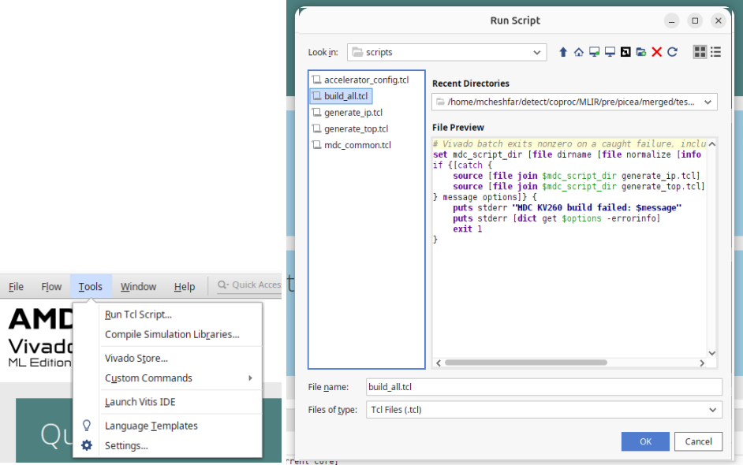
<figcaption>select tcl to run</figcaption>
</figure>

It make bitstream file automatically. You can file
`design_1_wrapper.bit` in build/top/run-\*\*\... .

Open the Vivado project: vivado build/top/run-\*\*/mdckv260.xpr ( Figure
[17](#fig:Blockdesign){reference-type="ref"
reference="fig:Blockdesign"})

<figure id="fig:Blockdesign" data-latex-placement="h">
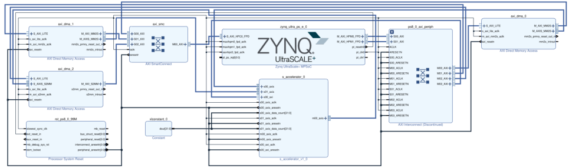
<figcaption>Block design for coprocessor</figcaption>
</figure>

**These Vivado build products are created after MDC generation.** Their
absence immediately after an MDC run does not indicate that coprocessor
generation has failed.

Inspect the Vivado timing and utilization reports before deployment. A
generated bitstream establishes that implementation completed; numerical
correctness must still be checked on the board using reference input and
output data.

## Linux Device Tree, Driver, and Userspace Utilities {#sec:linux-files}

The `linux` directory contains the software and hardware-description
sources used to access the accelerator from Kria Linux. Its main
components are the device-tree source, kernel driver, userspace
utilities, and build rules.

#### Device-tree source.

The generated `pl_mdc.dts` describes the programmable-logic resources
required by the Linux deployment, including the relevant register
regions and driver-binding information.

The source is compiled into a device-tree overlay for deployment. The
overlay must correspond to the hardware implemented by the loaded
bitstream.

#### Kernel driver.

The `driver` directory contains `mdc_dma.c` and its generated
configuration header, `mdc_config.h`. The driver provides the Linux
interface used by the userspace utilities to control accelerator
execution and DMA transfers.

Although the driver implementation is reusable, the configuration header
contains application-dependent information, including channel
organization, supported modes, buffer settings, and expected register
addresses.

Consequently, **the same driver source does not imply that one compiled
kernel module can be reused for every accelerator**. Build `mdc_dma.ko`
using the configuration generated for the selected hardware and headers
compatible with the running Kria kernel.

#### Userspace utilities.

The `userspace` directory contains the generated utilities for
inspecting and testing the accelerator. These include `mdc_probe` and
`mdc_test`, together with the corresponding application configuration.

The generated `mdc_test_config.h` describes the available ports, token
widths, modes, and active interfaces. The test application uses this
information to interpret named inputs and outputs, select a
configuration, submit transfers, and compare results against supplied
reference files.

## Network Configuration IDs and Generation Reports {#sec:configuration-reports}

MDC generates `configNetID.txt` to associate each functional
configuration with its runtime identifier. For the merged Roberts--Sobel
accelerator, these identifiers select the switching configuration
required to execute either Roberts or Sobel on the shared hardware.

Inspect this file before running the accelerator and use the mapping
produced by the current build. Configuration identifiers should not be
assumed to remain unchanged when the input networks or their ordering
change. When using the generated `mdc_test` utility, configurations can
be selected by the mode names recorded in its generated configuration,
for example through `--mode Sobel`.

For a network merged within PICEA, verify that the generated mapping
retains the original functional configurations. Although MDC receives a
single merged XDF file, the accelerator can still expose multiple
selectable modes.

The generated `report.txt` summarizes network composition and actor
sharing. It helps identify which actors are shared between
configurations and which remain specific to an individual network.

**The generation report describes the composed network; it does not
establish hardware performance or functional correctness.** Obtain FPGA
resource usage and timing results from Vivado reports, and verify
numerical correctness by comparing accelerator outputs with the
corresponding reference data.

Retain `configNetID.txt` and `report.txt` with the generated hardware
and Linux software so that the configuration mapping and composition
results remain traceable to the deployed build.

# OS-ORIENTED ACCELERATION MANAGEMENT ON KRIA KV260 {#sec:OS-ORIENTED }

1\. \[on your laptop/PC\] SD Flashing ---\> ([KV260 Ubuntu 22.04
image](https://people.canonical.com/~platform/images/xilinx/kria-ubuntu-22.04/iot-limerick-kria-classic-desktop-2204-20240304-165.img.xz))

<figure id="fig:flashSD" data-latex-placement="h">
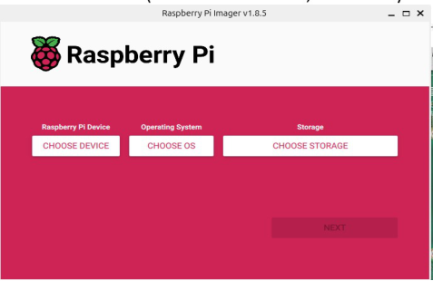
<figcaption>flash SD card with application on PC</figcaption>
</figure>

2\. Connect the board (via Ethernet or USB, or with keyboard/screen),
insert the SD, and turn the board on

<figure id="fig:kria" data-latex-placement="h">
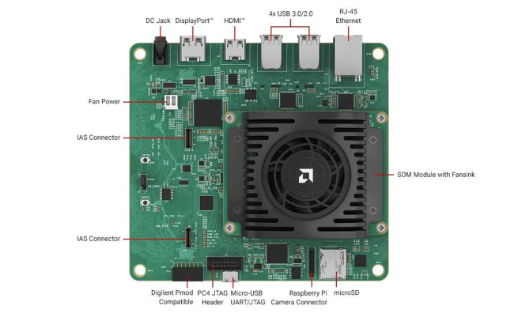
<figcaption>Kria KV260 board</figcaption>
</figure>

3\. (optional) \[on your laptop\] Control the board from via USB:

• Windows laptop: install Putty and open a serial connection (baudrate:
115200)

• Linux laptop: install picocom and run the following command (check if
ttyUSB1 is related to the board): sudo picocom -b 115200 /dev/ttyUSB1 .
\[on the board\] Access the OS (user/pw: ubuntu) and change password (at
least 8 characters)

<figure id="fig:login" data-latex-placement="h">
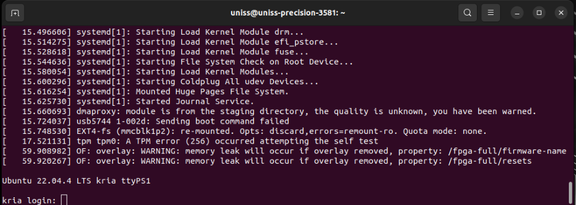
<figcaption>login in Kria Ubuntu</figcaption>
</figure>

<figure id="fig:readytouse" data-latex-placement="h">
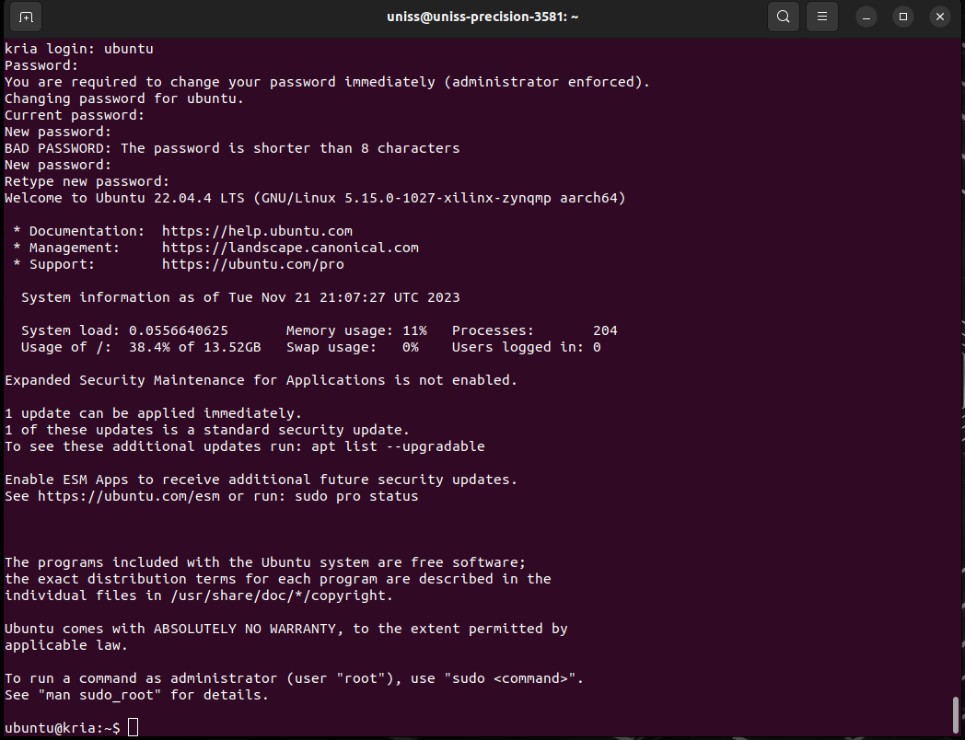
<figcaption>Kria Ubuntu is ready to use</figcaption>
</figure>

5\. (optional) Control the board from via Ethernet:

• \[on the board\] get the IP with the command (Figure
[22](#fig:getIP){reference-type="ref" reference="fig:getIP"}): ifconfig

• \[on your laptop\] access through SSH (the IP must be the same you get
with ifconfig)

ssh ubuntu@192.168.178.70

<figure id="fig:getIP" data-latex-placement="h">
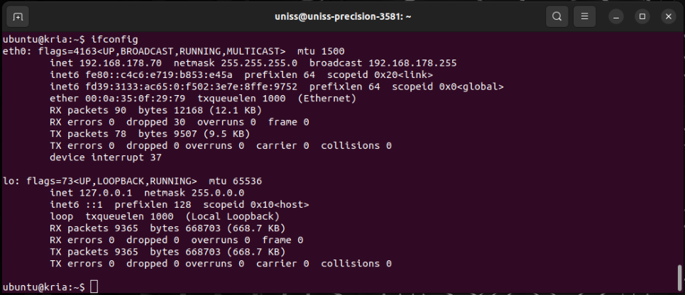
<figcaption>get the IP with the command</figcaption>
</figure>

# Deploying the Coprocessor on Kria Linux {#sec:kria-deployment}

Deployment requires the generated FPGA bitstream, device-tree overlay,
Linux kernel driver, and userspace utilities. These files must
correspond to the same accelerator build so that register addresses,
channel directions, and configuration identifiers remain consistent.

Copy the generated Linux package and the corresponding bitstream to the
Kria board. The following commands are executed on Kria unless otherwise
stated. Replace the example deployment paths with the actual file
locations.

## Building the Device-Tree Overlay and Linux Software {#sec:build-linux}

Open a terminal on Kria and enter the generated `linux` directory:

    cd /path/to/MDCoutput/linux

The board requires a C compiler, Make, the device-tree compiler, and
kernel headers matching the running Linux kernel. Check the kernel
version and its build directory:

    uname -r
    ls /lib/modules/$(uname -r)/build

Build the userspace utilities and device-tree overlay:

    make userspace overlay

The overlay target compiles the generated device-tree source into a
`.dtbo` file. The userspace target builds the accelerator inspection and
test utilities, including `mdc_probe` and `mdc_test`.

Build the kernel module against the running kernel:

    make module KDIR=/lib/modules/$(uname -r)/build

<figure id="fig:building" data-latex-placement="h">
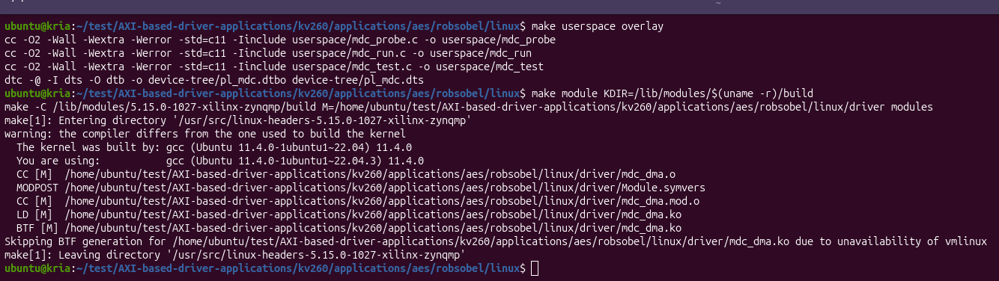
<figcaption>building usersapce and kernel example</figcaption>
</figure>

The resulting module is `driver/mdc_dma.ko`. It incorporates the
application-specific settings from `mdc_config.h`.

**Rebuild the driver and userspace utilities when the generated
accelerator configuration changes.** A module built for another kernel
or another channel configuration must not be assumed compatible. If the
kernel build directory is missing, install or prepare the matching
kernel headers before continuing.

## Loading the Bitstream, Overlay, and Driver {#sec:load-accelerator}

The following procedure uses `fpgautil` to load the programmable-logic
configuration and apply the corresponding device-tree overlay through
Linux FPGA Manager. It assumes that `fpgautil` and overlay support are
available in the board's Linux image.

#### Prepare the board.

Stop any application using the accelerator before replacing its hardware
configuration. If a previous `mdc_dma` module is loaded, unload it after
all clients have closed the device:

    lsmod | grep mdc_dma
    sudo rmmod mdc_dma

Run the removal command only when the module is loaded. Release any
previously loaded FPGA application and its overlay using the mechanism
that loaded them.Do not load a second configuration over an active
application.

#### Load the hardware and overlay.

From the generated `linux` directory, execute the following command
after replacing both paths:

    cd ..
    sudo fpgautil -R
    sudo fpgautil -b design_1_wrapper.bit
    sudo fpgautil -o linux/device-tree/pl_mdc.dtbo

The binary bitstream and overlay must describe the same hardware system.
The overlay must also be compatible with the base device tree of the
running Linux image.

Check the command result and kernel messages before loading the driver:

    sudo dmesg | tail -n 60

Do not continue if FPGA programming or overlay application reports an
error.

#### Load the kernel driver.

Insert the module built for this accelerator:

    sudo insmod linux/driver/mdc_dma.ko

After successful device binding, verify that the accelerator device is
available (Figure [24](#fig:device){reference-type="ref"
reference="fig:device"}):

    ls -l /dev/mdc_accel0
    ls /sys/class/misc/mdc_accel0
    sudo ./linux/userspace/mdc_probe

<figure id="fig:device" data-latex-placement="h">
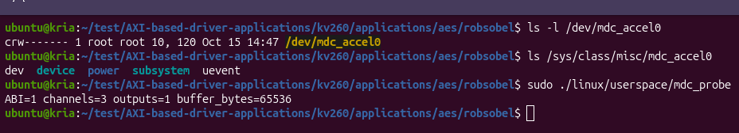
<figcaption>verification of the accelerator device available
example</figcaption>
</figure>

**Loading the module alone does not establish successful device
binding.** The driver also requires the matching device-tree node and
accessible hardware resources before it can expose `/dev/mdc_accel0`.

If the device node is missing, inspect the kernel log:

    sudo dmesg | tail -n 100

Check for overlay failures, driver probe errors, resource conflicts, or
discrepancies between the device-tree register addresses and the
generated driver configuration. Creating the device node manually does
not resolve these binding failures.

Once `mdc_probe` completes successfully, the system is ready for
functional testing with `mdc_test`. The next section describes how to
select Roberts or Sobel, transfer input data, and compare the
accelerator outputs with reference results.

# Testing and Validating the Accelerator {#sec:accelerator-validation}

After loading the hardware, applying the device-tree overlay, and
verifying driver access, use the generated `mdc_test` application to
execute each configuration and compare its output with reference data.

The commands below reproduce the previously validated $16 \times 16$
edge-detection test. They are executed from the deployment directory
containing the `linux` folder and the input and reference files.

Inspect the generated configuration before testing:

    ./linux/userspace/mdc_test --describe

The supplied merged MLIR declares in0 as the 6-bit size input, in1 as
the 8-bit pixel input, and out0 as the 8-bit result. Its configuration
metadata names the networks `Roberts` and `Sobel`.

Obtain numeric mode IDs, channel indices, buffer capacity, and active
ports from `--describe` and linux/include/mdc_test_config.h; these
values depend on the generated build.

## Preparing Input Data and Reference Outputs {#sec:validation-data}

Prepare the input image, the image-size parameter, and the reference
outputs for both algorithms. The example uses:

`in_size_file.mem`

:   The size parameter supplied through input port `in0`.

`in_pel_file.mem`

:   The image pixels supplied through input port `in1`.

`out0_Roberts_file.mem`

:   The reference output for Roberts.

`out0_Sobel_file.mem`

:   The reference output for Sobel.

Both configurations use the same input image and size parameter in this
test. Their reference outputs are different you can find the examples
here (link).

Use the memory-file format accepted by the generated test application.
These files contain numerical tokens; an image file such as PNG or JPEG
cannot be supplied directly without conversion.

The reference computation must use the same pixel ordering, arithmetic
widths, signedness, border handling, and output ordering as the
hardware. For this example, Roberts produces $15 \times 15 = 225$ output
tokens and Sobel produces $14 \times 14 = 196$ output tokens,
corresponding to valid processing without output padding.

**Reference data must correspond to the selected configuration and input
image.** A successful comparison against an unrelated reference does not
establish correctness of the intended computation.

## Selecting and Testing the Roberts Configuration {#sec:test-roberts}

Select the Roberts configuration using its generated mode name,
associate the input files with their ports, and specify both the output
destination and reference:

    sudo ./linux/userspace/mdc_test  --mode Roberts  --input in0=in_size_file.mem \
      --input in1=in_pel_file.mem  --output out0=out0_Roberts_actual.mem \
      --expect out0=out0_Roberts_file.mem

Use the mode spelling recorded in the generated configuration. In the
validated build, the Roberts mode is named `Roberts` and has
identifier 1.

The successful test produced:

    DMA transfers submitted for mode Roberts (id=1)
    in0 completed: status=0x00001002 bytes=4
    in1 completed: status=0x00001002 bytes=1024
    out0 completed: status=0x00001002 bytes=900
    out0: reference verified (225 tokens)

The output is saved to `out0_Roberts_actual.mem`. The
reference-verification message confirms that the application compared
the returned tokens with the supplied Roberts reference successfully.

## Selecting and Testing the Sobel Configuration {#sec:test-sobel}

Select Sobel using the same input files and its corresponding reference:

    sudo ./linux/userspace/mdc_test --mode Sobel  --input in0=in_size_file.mem \
      --input in1=in_pel_file.mem  --output out0=out0_Sobel_actual.mem \
      --expect out0=out0_top2_file.mem

In the validated build, the Sobel mode is named `Sobel` and has
identifier 2. Confirm the mapping in the current generated configuration
instead of assuming that these identifiers apply to every build.

The successful test produced:

    DMA transfers submitted for mode Sobel (id=2)
    in0 completed: status=0x00001002 bytes=4
    in1 completed: status=0x00001002 bytes=1024
    out0 completed: status=0x00001002 bytes=784
    out0: reference verified (196 tokens)

The output is saved to `out0_Sobel_actual.mem`. The smaller output count
reflects the larger Sobel kernel and the border-handling convention used
by this example.

## Verifying Numerical Results {#sec:verify-results}

Validation requires successful data transfers and agreement with the
numerical reference. **DMA completion alone does not demonstrate that
the accelerator computed the correct result.**

For the validated $16 \times 16$ example, the expected transfer sizes
are:

::: center
  Transfer                    Tokens   Bytes
  ------------------------- -------- -------
  Size parameter (`in0`)           1       4
  Input image (`in1`)            256    1024
  Roberts output (`out0`)        225     900
  Sobel output (`out0`)          196     784
:::

These byte counts correspond to four-byte transport words in this build.
They should not be inferred solely from the internal pixel width or
reused unchanged for other interface configurations.

Confirm that each execution reports the expected output-token count and
a successful reference comparison. If a transfer fails or the numerical
comparison reports a mismatch, check the selected mode, input-file
ordering, reference file, transfer sizes, and consistency of the
deployed hardware and software package.

Repeat each configuration with the same input, then alternate Roberts
and Sobel without reloading the bitstream. Compare every execution
against its reference to check repeated operation and configuration
switching, including possible effects of retained actor or FIFO state.

Retain the input files, reference outputs, actual outputs, console logs,
and build identifiers as the reproducible validation record.

# Links {#links .unnumbered}

<http://sites.unica.it/rpct/>

<https://gitlab.abinsula.com/myrtus/dpe/picea>

<https://github.com/mcheshfar/AXI-based-driver-applications>

<http://caph.univ-bpclermont.fr>

<https://github.com/mdc-suite/mdc/tree/mlir-frontend>

<https://docs.google.com/document/d/1G5cKw_gC97QreTQf8Wt6QaS4xfNMwW3k0dqt0z6wVLc/edit?tab=t.0#heading=h.s5si1wegx22v>

<http://www.oracle.com/technetwork/java/javase/downloads/jre8-downloads-2133155.html>

<https://www.amd.com/en/products/system-on-modules/kria/k26/kv260-vision-starter-kit.html>

<https://github.com/mcheshfar/AXI-based-driver-applications/tree/main/kv260/applications/edgedetection/MDC/MDC>

<https://gitlab.abinsula.com/myrtus/dpe/picea/-/tree/dec-mdc?ref_type=heads>

<https://www.amd.com/en/support/downloads/adaptive-socs-and-fpgas/development-tools/2026-1.html>

<https://www.researchgate.net/publication/278698706_CAPH_A_language_for_implementing_stream-processing_applications_on_FPGAs>

<https://drive.google.com/drive/folders/1au0F4E8QVDqZaL0TMWrrsKMHWlGEcQQM>

<https://drive.google.com/drive/folders/119dGOHhdyoGmOHCXryL6khIiJ3Ntfl9X>

<http://caph.univ-bpclermont.fr/>

<https://ieeexplore.ieee.org/document/1227149/>

<https://www.xilinx.com/support/documents/ip_documentation/axi_ref_guide/latest/ug761_axi_reference_guide.pdf>

<https://people.canonical.com/~platform/images/xilinx/kria-ubuntu-22.04/iot-limerick-kria-classic-desktop-2204-20240304-165.img.xz>
